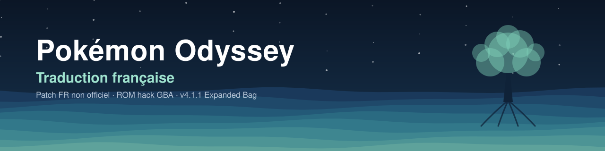

  

  
  
  
  

# Pokémon Odyssey – Traduction française

Traduction française non officielle de la ROM hack GBA **Pokémon Odyssey COMPLETE v4.1.1 (EXPANDED BAG)** : une aventure dans le Labyrinthe d'Yggdrasil et ses huit Strates, sur une base Pokémon Rouge Feu.

> **[⬇ Télécharger le dernier patch](https://github.com/Shadowix84/Pokemon-Odyssey-Fr/releases/latest)** · [Comment jouer](#comment-jouer) · [Signaler un bug](https://github.com/Shadowix84/Pokemon-Odyssey-Fr/issues/new/choose)

## Sommaire

- [Statut](#statut)
- [Avancement](#avancement)
- [Ce qui est traduit](#ce-qui-est-traduit)
- [Comment jouer](#comment-jouer)
- [Vérifier ta ROM](#vérifier-ta-rom)
- [Questions fréquentes](#questions-fréquentes)
- [Choix de traduction](#choix-de-traduction)
- [Limites connues](#limites-connues)
- [Feuille de route](#feuille-de-route)
- [Historique des versions](#historique-des-versions)
- [Signaler un bug ou proposer une traduction](#signaler-un-bug-ou-proposer-une-traduction)
- [Crédits](#crédits)

## Statut

- Version de la ROM d'origine : v4.1.1 (EXPANDED BAG)
- Version de la traduction : **FR4.1.6** (traduction partielle, en cours)
- Dans le menu principal, « Continue v4.1.1 » devient « Continuer FR4.1.6 »

## Avancement

| Partie du jeu | Avancement |
|---|---|
| Noms (Pokémon, attaques, talents, objets, lieux, dresseurs) | `██████████` 100 % |
| Menus et messages de combat | `██████████` 100 % |
| Descriptions des objets, talents et attaques | `██████████` 100 % |
| Dialogues | `██░░░░░░░░` 23 % (3 zones sur 16) |
| Descriptions du Pokédex | `░░░░░░░░░░` 0 % |
| Scripts d'événements | `░░░░░░░░░░` 0 % |
| Interface secondaire (messages système, aide…) | `░░░░░░░░░░` 0 % |

Au total, environ **27 %** des textes du jeu sont traduits (hors textes probablement jamais affichés).

## Ce qui est traduit

**Noms**
- 1 433 noms français officiels
- 65 noms officiels trop longs, abrégés dans le style des jeux GBA français (ex. Lance-Flamme, Superepousse)
- 193 noms inventés par le hack (ex. Médica, Éclat Abyssal, Ygg-Sangsue, type Éther)

**Lieux, classes et dresseurs**
- Route Côtière, les Strates, Cité Souterraine…
- Les champions officiels portent leur nom français (Major Bob, Ondine…)

**Menus et combats**
- Les menus visibles, la liste des quêtes et les messages de combat
- Les textes entièrement en italien sont traduits, dont les « {X} manda {Y} ! » qui apparaissaient en combat

**Descriptions**
- Les descriptions des 344 objets, 122 talents et 429 attaques
- Les 56 catégories du Pokédex inventées par le hack (ex. RenardDivin, LézardAvide, Nécromant)

**Dialogues d'Etria et des îles** *(nouveau en FR4.1.6)*
- Etria : Silva et son laboratoire, l'audience avec le roi Ramon et les événements du palais
- Le Club Krabby : les quêtes (philtre d'amour, Vieil Ambre, gâteau de mariage, Farfuret, Yanma) et un certain Teo
- Gorenil, l'île de l'automne, et la Ferme Talrega
- Les îles reprises de Rouge Feu (Île 1, Île 4, Port Île 3, Île du Lointain), avec les noms français officiels (Léo, Ciléo, Olga…)

**Dialogues de l'archipel** *(FR4.1.5)*
- La Mer de Galazeah : le paquebot, les routes maritimes à débloquer, les pirates et les Boss marins
- La Route Côtière : Saya et ses Formes d'Etria, le capitaine de l'Exploration Navale
- Le Mont Dentelé : Manfroy et l'énigme de la stèle
- Arundel : la potion d'Endurance et le Juge des surnoms

**Dialogues de Talrega** *(FR4.1.4)*
- Les retrouvailles au café de Lixin et les combats contre les Capitaines
- La Guilde des Aventuriers, Visil, le professeur Rennac et Annette
- La boutique de Rikkah, la loterie, la Maison des Combats, les panneaux et les textes d'aide (Endurance, points de minage, F.O.E., Échange Miracle)

## Comment jouer

1. **Télécharge la ROM d'origine** (Pokémon Odyssey COMPLETE v4.1.1, EXPANDED BAG), au choix :
   - [MediaFire](https://www.mediafire.com/file/1lka2b8zwav7c6j/Pok%C3%A9mon_Odyssey_COMPLETE_v4.1_%28EXPANDED_BAG%29.zip/file)
   - [Mega](https://mega.nz/file/5Yg2kDDC#4gft_XZ2_1P7Vc-cmcbz-EHWTOzGHqiXigRDyhQ0l2M)
   - [Discussion PokéCommunity](https://www.pokecommunity.com/threads/pokemon-odyssey-complete-v4-1-1.488536/)
2. **Télécharge le patch FR** (`Odyssey_patch_FR4.1.6.bps`) dans la section [Releases](../../releases) de ce dépôt.
3. **Applique le patch** avec [Rom Patcher JS](https://www.marcrobledo.com/RomPatcher.js/) : choisis ta ROM, puis le patch `.bps`, et applique le patch. Le site affiche aussi les empreintes de ta ROM, pour [vérifier](#vérifier-ta-rom) que c'est la bonne.
4. Lance la ROM obtenue sur émulateur ou console.

> Aucune ROM n'est distribuée ici : le patch ne fonctionne que sur la ROM d'origine v4.1.1 (EXPANDED BAG).
>
> Chaque patch s'applique directement sur la ROM d'origine : inutile d'appliquer les versions précédentes avant.

## Vérifier ta ROM

Le patch ne fonctionne que sur cette ROM exacte. Pour vérifier la tienne, ouvre-la dans [Rom Patcher JS](https://www.marcrobledo.com/RomPatcher.js/), le même site que pour appliquer le patch : il affiche son CRC32 et son SHA-1 dès que tu la charges.

| | Valeur |
|---|---|
| Taille | 32 Mo (33 554 432 octets) |
| CRC32 | `6C5EE1B2` |
| SHA-1 | `8745ddbdbfadf6abaf66de4e9055923b62eb4668` |

Si ta valeur est différente, ta ROM n'est pas la bonne version : retélécharge-la avec les liens ci-dessus.

Sans site internet

- **Mac** : dans le Terminal, tape `shasum -a 1 ` (avec l'espace), glisse ta ROM dans la fenêtre, puis appuie sur Entrée.
- **Windows** : dans l'invite de commandes, tape `certutil -hashfile "chemin\de\ta\rom.gba" SHA1`.

Compare le résultat avec le SHA-1 du tableau.

## Questions fréquentes

<b>Le patch refuse de s'appliquer</b>

Ta ROM n'est probablement pas la bonne : compare ses empreintes avec celles de la section [Vérifier ta ROM](#vérifier-ta-rom). Le patch ne marche que sur la v4.1.1 EXPANDED BAG, sans aucun autre patch.

<b>Faut-il appliquer les patchs précédents d'abord ?</b>

Non. Chaque patch s'applique directement sur la ROM d'origine. Prends simplement le plus récent.

<b>Ma sauvegarde de la version anglaise marche-t-elle ?</b>

La traduction ne modifie que les textes du jeu : une sauvegarde de la v4.1.1 devrait fonctionner. Fais quand même une copie de ton fichier de sauvegarde avant. Les noms que tu as déjà saisis (ton personnage, les surnoms de tes Pokémon) restent tels quels.

<b>Sur quel émulateur jouer ?</b>

Ceux que conseille le hack :
- **PC / Mac** : mGBA (dernière version)
- **Android** : MyBoy, PizzaBoy, RetroArch (cœur mGBA), Lemuroid
- **iOS** : Delta, RetroArch (cœur mGBA), 44VBA

<b>Pourquoi certains textes sont-ils encore en anglais ?</b>

La traduction avance zone par zone : regarde l'[avancement](#avancement) et la [feuille de route](#feuille-de-route). Si un texte d'une zone déjà traduite est resté en anglais, [signale-le](https://github.com/Shadowix84/Pokemon-Odyssey-Fr/issues/new/choose).

<b>Quand sort la prochaine version ?</b>

Il n'y a pas de date fixe : chaque nouvelle version ajoute une zone de dialogues. Les sorties sont annoncées sur le [serveur Discord](https://discord.gg/c7SMEeAm9s).

## Choix de traduction

- Tout le monde tutoie Nyx, et les accords sont au féminin.
- Les mots italiens et romains de Kitt et Rockey sont gardés (daje, anvedi, fidate…).
- Les noms propres inventés restent tels quels (Nyx, Talrega, Yggdrasil) ; les noms descriptifs sont traduits (Coastal Road → Route Côtière).
- Les textes repris de Rouge Feu utilisent les noms français officiels (Olga, Aldo, Peter, Léo, Prof. Chen, Carmin sur Mer…).
- Nyx vouvoie le roi d'Etria (« Votre Majesté »).
- Chaque personnage garde sa façon de parler : Brody en pirate, Karin avec son parler campagnard, Olympia avec son ton de robot, Manfroy qui s'emporte en majuscules.

## Limites connues

Environ 200 textes sont plus larges que l'original. Après vérification avec la police du jeu, la plupart ont la place de s'afficher ; une centaine de libellés de menu (ex. « NOUVEAU NOM », « Point de cueillette ») peuvent encore être coupés à l'écran et sont en cours de vérification en jeu.

## Feuille de route

Les prochaines versions traduisent les dialogues zone par zone, dans l'ordre de l'histoire :

- [x] Talrega (FR4.1.4)
- [x] Mer de Galazeah, Route Côtière, Mont Dentelé, Arundel (FR4.1.5)
- [x] Etria, Club Krabby, Gorenil, Ferme Talrega (FR4.1.6)
- [ ] Première Strate, Labo Abandonné, Yggdrasil, Centre d'Échange
- [ ] Deuxième Strate, Grottes de Sable, Repaire des Voleurs, Désert de Golgonda…
- [ ] Troisième Strate, Café Meumeu, Station Aqua, Temple Marin, Charon…
- [ ] Quatrième Strate, Limbes, Grotte des Âges, Cité Souterraine, Bois Perdus…
- [ ] Cinquième Strate, Sanctuaire Profond, Chambre Abyssale
- [ ] Sixième Strate, Fort Abyssal, Cimetière Etria
- [ ] Septième Strate, Labo Porcelaine, Antre Porcelaine, Éclat Abyssal
- [ ] Huitième Strate, Palais Abyssal, Varley
- [ ] Zones annexes (Île des Pirates, Bois Cascade, Île Érable, Atoll du Nord…)
- [ ] Les fins
- [ ] Descriptions du Pokédex, scripts d'événements et interface secondaire

## Historique des versions

| Version | Contenu |
|---|---|
| FR4.1.6 | Dialogues d'Etria, du Club Krabby, de Gorenil, de la Ferme Talrega et des îles reprises de Rouge Feu |
| FR4.1.5 | Dialogues de la Mer de Galazeah, de la Route Côtière, du Mont Dentelé et d'Arundel |
| FR4.1.4 | Dialogues de Talrega (café de Lixin, Capitaines, Guilde, panneaux) |
| FR4.1.3 | Descriptions des objets, talents et attaques ; catégories du Pokédex inventées par le hack |
| FR4.1.2 | Première version : noms, lieux, dresseurs, menus et messages de combat |

Le détail de chaque version est dans le [journal des modifications](CHANGELOG.md).

## Signaler un bug ou proposer une traduction

Tout passe par les **[issues GitHub](https://github.com/Shadowix84/Pokemon-Odyssey-Fr/issues/new/choose)**, avec deux formulaires :

- **Signaler un bug ou une faute** : texte coupé, en anglais, faute, jeu figé, patch qui ne s'applique pas ;
- **Proposer une meilleure traduction** : une formulation plus juste ou plus naturelle.

Indique ta version (ex. FR4.1.6), l'endroit dans le jeu et, si possible, une capture d'écran. Pour aider autrement (tester une version, par exemple), lis le [guide de contribution](CONTRIBUTING.md).

Le [serveur Discord](https://discord.gg/c7SMEeAm9s) sert à discuter et à suivre les nouveautés.

## Crédits

- Équipe de Pokémon Odyssey, pour la ROM hack d'origine
- Traduction française : Shadowix84

## Mentions

Projet de fans, non officiel et gratuit. Pokémon est une marque de Nintendo, Game Freak et The Pokémon Company.
Aucune ROM n'est fournie : seul le patch de traduction est distribué.
