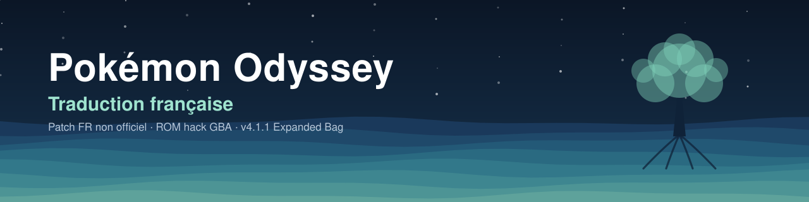

  

  
  
  

# Pokémon Odyssey – Traduction française

Traduction française non officielle de la ROM hack GBA **Pokémon Odyssey COMPLETE v4.1.1 (EXPANDED BAG)** : une aventure dans le Labyrinthe d'Yggdrasil et ses huit Strates, sur une base Pokémon Rouge Feu.

> **[⬇ Télécharger le dernier patch](https://github.com/Shadowix84/Pokemon-Odyssey-Fr/releases/latest)** · [Comment jouer](#comment-jouer) · [Signaler un bug](https://github.com/Shadowix84/Pokemon-Odyssey-Fr/issues/new/choose) · 🇬🇧 [In English](#in-english)

## Bande-annonce

1 minute, avec musique : l'histoire, les menus, l'écran Résumé et un combat, filmés dans la version FR4.1.37. Clique sur ▶ pour la lancer.

https://github.com/user-attachments/assets/ea241219-a7ea-442f-a64d-4d372a4e4d79

<a href="https://github.com/Shadowix84/Pokemon-Odyssey-Fr/raw/main/assets/bande-annonce.mp4">⬇ Télécharger la vidéo (MP4, 6,5 Mo)</a>

## Sommaire

- [Bande-annonce](#bande-annonce)
- [Statut](#statut)
- [Ce qui est traduit](#ce-qui-est-traduit)
- [Comment jouer](#comment-jouer)
- [Vérifier ta ROM](#vérifier-ta-rom)
- [Questions fréquentes](#questions-fréquentes)
- [Choix de traduction](#choix-de-traduction)
- [Versions à éviter](#versions-à-éviter)
- [Limites connues](#limites-connues)
- [Historique des versions](#historique-des-versions)
- [Signaler un bug ou proposer une traduction](#signaler-un-bug-ou-proposer-une-traduction)
- [Crédits](#crédits)
- [In English](#in-english)
- [Mentions](#mentions)

## Statut

- **Traduction complète** : FR4.1.37, pour Pokémon Odyssey COMPLETE v4.1.1 (EXPANDED BAG), base Rouge Feu anglaise (« 1636 - Pokémon Fire Red (U)(Squirrels) »)
- Dans le menu principal, « Continue v4.1.1 » devient « Continuer v4.1.37 »
- Chaque version passe des contrôles automatiques avant d'être publiée : relecture de la ROM, tests sur émulateur (démarrage, combats, montée de niveau, parties au hasard) et recherche des textes restés en anglais

> ⚠️ **Les versions avant FR4.1.30 ont des bugs** (le jeu peut se figer quand un Pokémon hors combat monte de niveau). Mets à jour : ta sauvegarde reste compatible. Détail dans [Versions à éviter](#versions-à-éviter).

## Ce qui est traduit

**Tout le texte du jeu**, avec les noms français officiels quand ils existent.

| Partie | Contenu |
|---|---|
| **Noms** | Pokémon, attaques, talents, objets, lieux, classes et dresseurs : 1 433 noms officiels, 65 abrégés pour tenir à l'écran (ex. Lance-Flamme), 193 noms inventés par le hack traduits ou adaptés (ex. Éclat Abyssal, Ygg-Sangsue, type Éther) |
| **Menus et combats** | Menus, liste et en-tête des quêtes, messages de combat, SAC, PC, BOUTIQUE, système d'AIDE, Messagerie, et les étiquettes dessinées en images (écran Résumé, icônes de type, carte de dresseur) |
| **Descriptions** | 344 objets, 122 talents, 429 attaques, et les 410 fiches du Pokédex avec les mesures en système métrique |
| **Dialogues** | Toute l'histoire, de Talrega aux huit Strates et aux trois fins, les quêtes annexes et les zones de l'après-guerre |
| **Scripts du hack** | Journal de quête, Codex, vérificateur d'IV/EV, niveau maximum, Mode Normal / Difficile, et les scènes restées en italien dans la version anglaise |
| **Rouge Feu** | Les textes repris de Rouge Feu (villes, ARÈNES, ÎLES SEVII…) et ceux restés dans la ROM, avec les noms officiels |
| **Crédits** | Les rubriques et les messages de remerciement de l'équipe du hack |

Le détail, version par version, est dans le [journal des modifications](CHANGELOG.md).

## Comment jouer

Il faut appliquer **deux patchs**, l'un après l'autre : d'abord celui du hack (en anglais), puis celui de la traduction.

1. **Procure-toi la ROM anglaise de Pokémon Rouge Feu** : **« 1636 - Pokémon Fire Red (U)(Squirrels) »**, c'est-à-dire *Pokémon FireRed* en version anglaise (américaine), v1.0, à partir de ta propre cartouche. La version française de Rouge Feu ne marche pas. Cette ROM n'est fournie ni ici, ni avec le hack.
2. **Télécharge le hack Pokémon Odyssey** (v4.1.1, EXPANDED BAG), au choix :
   - [MediaFire](https://www.mediafire.com/file/1lka2b8zwav7c6j/Pok%C3%A9mon_Odyssey_COMPLETE_v4.1_%28EXPANDED_BAG%29.zip/file)
   - [Mega](https://mega.nz/file/5Yg2kDDC#4gft_XZ2_1P7Vc-cmcbz-EHWTOzGHqiXigRDyhQ0l2M)
   - [Discussion PokéCommunity](https://www.pokecommunity.com/threads/pokemon-odyssey-complete-v4-1-1.488536/)

   Tu obtiens un dossier avec des instructions en anglais (`HOW_TO_PLAY.txt`) et le patch `Odyssey.ups`.
3. **Applique le patch du hack** avec [Rom Patcher JS](https://www.marcrobledo.com/RomPatcher.js/) : dans *ROM file*, choisis `Pokémon Fire Red (U)(Squirrels).gba` ; dans *Patch file*, choisis `Odyssey.ups` ; puis clique sur *Apply patch*. Tu obtiens **Pokémon Odyssey COMPLETE v4.1.1 (EXPANDED BAG)**, en anglais. [Vérifie](#vérifier-ta-rom) ses empreintes : le site les affiche.
4. **Télécharge le patch FR** (`Odyssey_patch_FR4.1.37.bps`) dans la section [Releases](../../releases) de ce dépôt.
5. **Applique le patch FR** avec Rom Patcher JS : choisis cette fois la ROM obtenue à l'étape 3, puis le patch `.bps`.
6. Lance la ROM obtenue sur émulateur ou console.

> Si Rom Patcher JS te renvoie un fichier `.txt` au lieu d'un `.gba`, renomme simplement son extension en `.gba`.

> Aucune ROM n'est distribuée ici, seulement le patch de traduction.
>
> Le patch FR s'applique sur la ROM Odyssey v4.1.1 (EXPANDED BAG) obtenue à l'étape 3 : inutile d'appliquer les versions FR précédentes avant.

## Vérifier ta ROM

Chaque patch ne fonctionne que sur une ROM exacte. Pour vérifier la tienne, ouvre-la dans [Rom Patcher JS](https://www.marcrobledo.com/RomPatcher.js/), le même site que pour appliquer les patchs : il affiche son CRC32 et son SHA-1 dès que tu la charges.

| | Pokémon Fire Red (U)(Squirrels), anglais (avant le patch `.ups`) | Odyssey v4.1.1 EXPANDED BAG (avant le patch FR) |
|---|---|---|
| Taille | 16 Mo (16 777 216 octets) | 32 Mo (33 554 432 octets) |
| CRC32 | `DD88761C` | `6C5EE1B2` |
| SHA-1 | `41cb23d8dccc8ebd7c649cd8fbb58eeace6e2fdc` | `8745ddbdbfadf6abaf66de4e9055923b62eb4668` |

Si ta valeur est différente, ce n'est pas la bonne ROM : pour Rouge Feu, il faut la version anglaise « 1636 - Pokémon Fire Red (U)(Squirrels) », pas la version française ; pour Odyssey, refais l'étape 3 à partir de cette ROM Rouge Feu.

Sans site internet

- **Mac** : dans le Terminal, tape `shasum -a 1 ` (avec l'espace), glisse ta ROM dans la fenêtre, puis appuie sur Entrée.
- **Windows** : dans l'invite de commandes, tape `certutil -hashfile "chemin\de\ta\rom.gba" SHA1`.

Compare le résultat avec le SHA-1 du tableau.

## Questions fréquentes

<b>Le patch refuse de s'appliquer</b>

Ta ROM n'est probablement pas la bonne : compare ses empreintes avec celles de la section [Vérifier ta ROM](#vérifier-ta-rom). Vérifie aussi l'ordre : le patch `.ups` du hack s'applique sur Rouge Feu, puis le patch FR `.bps` sur la ROM Odyssey obtenue, sans aucun autre patch.

<b>Faut-il appliquer les patchs précédents d'abord ?</b>

Non. Chaque patch FR s'applique directement sur la ROM Odyssey v4.1.1 (EXPANDED BAG). Prends simplement le plus récent.

<b>Ma sauvegarde de la version anglaise marche-t-elle ?</b>

La traduction ne modifie que les textes du jeu : une sauvegarde de la v4.1.1 devrait fonctionner. Fais quand même une copie de ton fichier de sauvegarde avant. Pour que l'émulateur la retrouve, donne-lui le même nom que la nouvelle ROM (par exemple `Pokémon Odyssey COMPLETE FR4.1.37 EXPANDED BAG.sav`). Les noms que tu as déjà saisis (ton personnage, les surnoms de tes Pokémon) restent tels quels.

<b>Sur quel émulateur jouer ?</b>

Ceux que conseille le hack :
- **PC / Mac** : mGBA (version portable), VBA, VBA-M
- **Android** : MyBoy, PizzaBoy, RetroArch (cœur mGBA), Lemuroid
- **iOS** : Delta, RetroArch (cœur mGBA), 44VBA

Le jeu fonctionne aussi sur une vraie Game Boy Advance (avec une cartouche flash) et sur les consoles portables comme les Anbernic.

<b>Je vois encore un texte en anglais</b>

Tout le texte du jeu est traduit : [signale-le](https://github.com/Shadowix84/Pokemon-Odyssey-Fr/issues/new/choose) avec une capture. Seuls les titres des musiques du juke-box sont volontairement gardés en anglais.

<b>Quand sort la prochaine version ?</b>

Il n'y a pas de date fixe : les nouvelles versions corrigent les problèmes signalés dans les issues. Elles sont publiées dans les [Releases](https://github.com/Shadowix84/Pokemon-Odyssey-Fr/releases). Pour être prévenu, clique sur **Watch** → **Custom** → **Releases** en haut de cette page.

## Choix de traduction

- Tout le monde tutoie Nyx, et les accords sont au féminin.
- Les mots italiens et romains de Kitt et Rockey sont gardés (daje, anvedi, fidate…).
- Les noms propres inventés restent tels quels (Nyx, Talrega, Yggdrasil) ; les noms descriptifs sont traduits (Coastal Road → Route Côtière).
- Les textes repris de Rouge Feu utilisent les noms français officiels (Olga, Aldo, Peter, Léo, Prof. Chen, Carmin sur Mer…).
- Nyx vouvoie le roi d'Etria (« Votre Majesté »).
- Chaque personnage garde sa façon de parler : Brody en pirate, Karin avec son parler campagnard, Olympia avec son ton de robot, Manfroy qui s'emporte en majuscules.
- Les titres des musiques du juke-box restent en anglais, comme dans les bandes originales.

## Versions à éviter

L'outil de traduction avait modifié par erreur quelques octets qui ne sont pas du texte. Un audit complet de la ROM (FR4.1.30) a tout corrigé. **Utilise toujours la dernière version** ; ta sauvegarde reste compatible.

| Bug | Versions touchées | Corrigé dans |
|---|---|---|
| Le jeu **se fige** quand un Pokémon de l'équipe resté hors du combat monte de niveau (Multi Exp., capture…) | FR4.1.5 à FR4.1.28 | FR4.1.30 |
| Deux autres morceaux du code du jeu abîmés (plantage possible) | FR4.1.5 à FR4.1.28 | FR4.1.30 |
| Combat contre le Garçon de la Sixième Strate (plantage possible) | FR4.1.14 à FR4.1.28 | FR4.1.30 |
| Scène du Lokhlass à la Station Aqua (déplacement du PNJ cassé) | FR4.1.14 à FR4.1.28 | FR4.1.30 |
| Quelques données du jeu légèrement abîmées (graphismes, sons) | FR4.1.2 à FR4.1.28 | FR4.1.30 |
| Souvenir d'Olympia devant la tombe d'Hephaestus, dans l'Antre Porcelaine (texte illisible ou plantage) | FR4.1.17 à FR4.1.19 | FR4.1.20 |

## Limites connues

- Une quinzaine de libellés de menu restent à voir en jeu (ex. le menu des natures « Jovial (+Vitesse -Att. Spé.) ») : ils pourraient être coupés à l'écran. Les autres ont été vérifiés sur émulateur.
- Le petit « HP » vert à côté des barres de vie (combat, équipe, résumé) reste en anglais.
- Les étiquettes en images sont en petites capitales sans accent, faute de place (DEFENSE, ELECTR, ETHER).
- La taille des Magicarpe et des Scarhino s'affiche en pouces : c'est le jeu d'origine qui fait ce calcul.

## Historique des versions

⚠️ = version avec des bugs, corrigés dans FR4.1.30 (voir [Versions à éviter](#versions-à-éviter)).

| Version | Contenu |
|---|---|
| FR4.1.37 | Relecture complète : écran titre (« Options », « Pokédex : », « Strate : »), sbires de la TEAM ROCKET nommés « SBIRE » comme dans Rouge Feu, quelques mots corrigés |
| FR4.1.36 (regroupe FR4.1.35) | Étiquettes en images traduites : écran Résumé (NOM, OBJET, ATTAQUE, VITESSE…), icônes de type (FEU, EAU, PLANTE…), carte de dresseur (No ID, STRATES) ; en combat, « Que doit faire … ? » sur deux lignes |
| FR4.1.34 | Libellés de menu vérifiés à l'écran ; 4 textes raccourcis car coupés ou trop larges (aide de la page Capacités du résumé, quête du sanglier, messages du PC) |
| FR4.1.33 | Derniers textes anglais traduits (6 messages de défaite de dresseurs, 4 mots de la Messagerie) ; termes harmonisés (Avis Pokédex, Niveau maximum, énergie éthérée) ; scan final automatique à chaque version |
| FR4.1.32 | En-tête du menu des quêtes en français (« Quêtes annexes », « Préc. », « Suiv. ») (issue #6) |
| FR4.1.31 | Message de la boutique « Voilà ! Merci ! » traduit ; descriptions des CT et CS remises en forme pour la Boîte CT (issues #2 et #3) |
| FR4.1.30 | **Correctif important** : gel au gain de niveau hors combat et autres octets modifiés par erreur dans toutes les versions précédentes (audit complet de la ROM) ; message de gain d'EXP, descriptions du SAC, « Temps », « Argent », écran Continuer (regroupe FR4.1.29) |
| FR4.1.28 | ⚠️ Traduction complète : crédits de fin et textes de Rouge Feu restés dans la ROM (regroupe FR4.1.24 à FR4.1.27) |
| FR4.1.23 | ⚠️ Scripts du hack (Journal de quête, Codex, niveau maximum, scènes de Karin restées en italien) et interface secondaire de Rouge Feu (AIDE, VÉRIF. STARS, messages des menus) (regroupe FR4.1.21 et FR4.1.22) |
| FR4.1.20 | ⚠️ Descriptions du Pokédex (410 fiches) ; correction du souvenir d'Hephaestus dans l'Antre Porcelaine, cassé depuis FR4.1.17 |
| FR4.1.19 | ⚠️ Dialogues des fins (vraie fin, fin normale, épilogue) et de Cramois'Île : tous les dialogues de l'histoire sont traduits |
| FR4.1.18 | ⚠️ Dialogues du combat final (Combes Bordeaux), de la mauvaise fin, des rencontres de l'après-guerre (Barry, Silver, Zinnia) et des super F.O.E. du Bois Cascade et de l'Atoll du Nord |
| FR4.1.17 | ⚠️ Dialogues de l'Antre Porcelaine, de l'Éclat Abyssal, de la Huitième Strate, du Palais Abyssal (fin de la Partie 4) et de Varley ; Céladopole reprise de Rouge Feu (regroupe FR4.1.16) |
| FR4.1.15 | ⚠️ Dialogues de la Septième Strate, du Labo Porcelaine et du Temple de Porcelaine |
| FR4.1.14 | ⚠️ Dialogues de la Station Aqua, de Charon, des Quatrième, Cinquième et Sixième Strates, de la Cité Souterraine, du Fort Abyssal et du Cimetière d'Etria (regroupe FR4.1.10 à FR4.1.13) |
| FR4.1.9 | ⚠️ Dialogues des Première, Deuxième et Troisième Strates, du Labo Abandonné, du Repaire des Voleurs et du Café Meumeu (regroupe FR4.1.7 et FR4.1.8) |
| FR4.1.6 | ⚠️ Dialogues d'Etria, du Club Krabby, de Gorenil, de la Ferme Talrega et des îles reprises de Rouge Feu |
| FR4.1.5 | ⚠️ Dialogues de la Mer de Galazeah, de la Route Côtière, du Mont Dentelé et d'Arundel |
| FR4.1.4 | ⚠️ Dialogues de Talrega (café de Lixin, Capitaines, Guilde, panneaux) ; descriptions des objets, talents et attaques ; catégories du Pokédex inventées par le hack (regroupe FR4.1.3) |
| FR4.1.2 | ⚠️ Première version : noms, lieux, dresseurs, menus et messages de combat |

Le détail de chaque version est dans le [journal des modifications](CHANGELOG.md).

## Signaler un bug ou proposer une traduction

Tout passe par les **[issues GitHub](https://github.com/Shadowix84/Pokemon-Odyssey-Fr/issues/new/choose)**, avec deux formulaires :

- **Signaler un bug ou une faute** : texte coupé, en anglais, faute, jeu figé, patch qui ne s'applique pas ;
- **Proposer une meilleure traduction** : une formulation plus juste ou plus naturelle.

Indique ta version (ex. FR4.1.37), l'endroit dans le jeu et, si possible, une capture d'écran. Pour aider autrement (tester une version, par exemple), lis le [guide de contribution](CONTRIBUTING.md).

## Crédits

- Équipe de Pokémon Odyssey, pour la ROM hack d'origine
- Traduction française : Shadowix84

## In English

**What is this?** ([trailer](https://github.com/Shadowix84/Pokemon-Odyssey-Fr/blob/main/assets/bande-annonce.mp4)) An unofficial, fan-made French translation of the GBA ROM hack **Pokémon Odyssey COMPLETE v4.1.1 (EXPANDED BAG)**, based on Pokémon FireRed. The translation is complete: names, menus, battle messages, descriptions, all of the story dialogue, the Pokédex, event scripts and the credits are in French.

**Versions before FR4.1.30 have bugs** (the game can freeze when a party Pokémon that did not battle levels up). Always use the latest patch: save files are compatible.

**How to play**
1. Start from your own English **"1636 - Pokémon Fire Red (U)(Squirrels)"** ROM (CRC32 `DD88761C`).
2. Download Pokémon Odyssey v4.1.1 EXPANDED BAG (links in [Comment jouer](#comment-jouer)): it comes as a folder with `HOW_TO_PLAY.txt` and the `Odyssey.ups` patch. Apply that `.ups` patch to FireRed with [Rom Patcher JS](https://www.marcrobledo.com/RomPatcher.js/). The result should have CRC32 `6C5EE1B2`.
3. Download the latest French `.bps` patch from the [Releases](https://github.com/Shadowix84/Pokemon-Odyssey-Fr/releases/latest), apply it to the Odyssey ROM from step 2, then play on any GBA emulator or handheld.

No ROM is distributed here, only the translation patch. Each French patch applies directly to the Odyssey v4.1.1 EXPANDED BAG ROM.

**Bugs and feedback:** open an [issue](https://github.com/Shadowix84/Pokemon-Odyssey-Fr/issues/new/choose) (English is fine).

**Credits:** the Pokémon Odyssey team for the original hack; French translation by Shadowix84.

## Mentions

Projet de fans, non officiel et gratuit. Pokémon est une marque de Nintendo, Game Freak et The Pokémon Company.
Aucune ROM n'est fournie : seul le patch de traduction est distribué.
